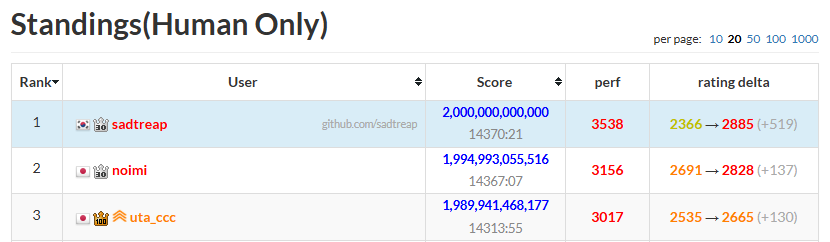

import Sheets from "@/components/experiments/ahc074/Sheets.astro";
import GroupSizes from "@/components/experiments/ahc074/GroupSizes.astro";

[AHC074](https://atcoder.jp/contests/ahc074)는 구멍 뚫린 종이 시트를 겹쳐서 원하는 바코드를 만드는 문제였다. 시트 무늬는 처음에 한 번 정하면 바꿀 수 없고, 그 뒤로 할 수 있는 건 시트를 한 장 뽑아서 다른 깊이에 다시 꽂는 것뿐이다.

10일짜리 대회였고 AI 부문이 따로 열렸는데, 나는 인간 부문으로 참가했다. AHC치고는 문제가 꽤 단순해서 관찰 몇 가지가 승패를 가를 거라고 생각했다.

처음에는 가장 쉬운 방법부터 떠올렸다. 윈도우마다 흰 시트와 검은 시트를 한 장씩 두고 색을 바꿀 때마다 둘의 위아래를 뒤집는 것이다. 연속한 두 바코드는 평균 32개 윈도우가 다르니 주문당 32회가 든다. 반대로 바코드를 통째로 찍은 시트를 맨 위로 올리면 1회로 끝난다.

---

## 문제

윈도우 64개 위에 시트 192장이 겹쳐 있다. 시트에는 윈도우마다 `0`(흰색), `1`(검정), `.`(구멍) 중 하나가 찍혀 있고, 각 윈도우에는 구멍이 아닌 시트 중 가장 위에 있는 것의 색이 보인다. 연산 1회는 어느 윈도우로든 보이는 시트 한 장을 뽑아 원하는 깊이에 다시 꽂는 것이다.

<figure>
  <Sheets ids={["ex0", "ex1"]} />
  <figcaption>문제의 예시. 진한 글자가 윈도우로 보이는 칸이다. 시트 0을 맨 아래로 보내면 바코드가 1001에서 1100이 된다.</figcaption>
</figure>

아이템은 256종이고 바코드는 1이 32개인 길이 64 문자열이다. 바코드 목록을 보고 시트 무늬를 정하면 주문 1,024개가 하나씩 들어온다. 연속한 두 주문은 항상 다른 아이템이다. 점수는 $384 \times (\text{오답 수}) + (\text{연산 수})$이므로 오답 없이 연산 수를 줄이는 게 목표다.

---

## 1. 통째로 찍은 시트

아이템마다 바코드를 통째로 찍은 시트를 만들려면 걸림돌이 두 개 있다.

1. 가려진 시트는 뽑을 수 없다. 구멍 없는 시트를 쌓으면 맨 위 한 장만 보인다.
2. 시트가 모자란다. 시트는 192장인데 아이템은 256종이다.

<figure>
  <Sheets ids={["opq"]} />
  <figcaption>X는 한 칸도 보이지 않아서 뽑을 수 없다.</figcaption>
</figure>

---

## 2. 가려진 시트

윈도우 64개를 **그룹 윈도우** 26개와 **베이스 윈도우** 38개로 나눈다. 아이템 시트는 그룹 0부터 25 중 하나에 속하고, 그룹 $q$의 시트는 그룹 윈도우 중 0번부터 $q$번까지만 칠한다. 베이스 윈도우는 모두 칠한다.

시트를 그룹 순서대로 쌓아 두면 그룹 윈도우 $q$를 칠하는 시트는 그룹 $q$ 이상뿐이므로, 그룹 $q$의 맨 위 시트(이하 **윗장**)는 윈도우 $q$로 항상 보인다. 묻힌 시트도 그 위의 장들을 같은 그룹 아래로 내리면 윗장이 되어 뽑을 수 있다.

주문받은 아이템의 시트(이하 **주문 시트**)를 이렇게 파내서 맨 위로 올리면 베이스 윈도우와 그룹 윈도우 0번부터 $q$번까지가 한 번에 맞는다. 나머지 그룹 윈도우에는 각 그룹의 윗장이 보이므로, 윗장을 같은 그룹 아래로 내려 다음 장이 보이게 해서 맞춘다. 이를 **윗장 교체**라 부르겠다.

<figure>
  <Sheets ids={["s4a", "s4b"]} />
  <figcaption>윈도우 0, 1, 2가 그룹 윈도우이고 3부터 7이 베이스 윈도우인 축소판이다. ① 3을 내려 X를 파내고 ② X를 맨 위로 올리면 윈도우 7개가 맞는다. ③ 남은 윈도우 2는 그룹 2의 윗장 교체로 맞춘다.</figcaption>
</figure>

---

## 3. 모자란 시트

6장은 뒤에서 설명할 **베이스 시트**로 쓰므로, 남은 186장에 256종을 담으려면 70쌍은 시트 한 장을 같이 써야 한다. 이런 **페어 시트**에는 두 바코드가 같은 칸만 칠하고 다른 칸은 구멍으로 둔다.

<figure>
  <Sheets ids={["pair"]} />
  <figcaption>X와 Y가 다른 칸 3개가 구멍이 된다.</figcaption>
</figure>

구멍으로는 아래 시트가 보인다. 그룹 윈도우의 구멍은 그 그룹의 윗장이, 베이스 윈도우의 구멍은 주문 시트 바로 아래 깔린 베이스 시트가 메운다. 단, 페어 시트는 자기 그룹 윈도우 $q$에서는 두 바코드가 같아야 한다. 거기가 구멍이면 윗장이 되어도 보이지 않아 뽑을 수 없다.

---

## 4. 베이스 시트

베이스 시트는 베이스 윈도우만 칠하고, 베이스 윈도우 하나는 6장 중 정확히 두 장에만 하나는 `0`, 하나는 `1`로 찍는다. 그 윈도우에는 둘 중 위에 있는 쪽의 색이 보이므로, 베이스 시트의 순서만 바꿔 페어 시트 구멍들의 색을 정할 수 있다.

<figure>
  <Sheets ids={["s5x", "s5y"]} arrow={false} />
  <figcaption>베이스 시트를 3장으로 줄인 예다. 같은 페어 시트 P라도 베이스 시트의 순서에 따라 X도 되고 Y도 된다.</figcaption>
</figure>

X를 만들려면 윈도우 3에서 B가 A 위에, 윈도우 5에서 C가 B 위에 있어야 하고, Y는 그 반대다. 이렇게 아이템 하나가 구멍마다 만드는 **순서 조건**이 서로 충돌하거나 순환하면 어떤 순서로도 맞출 수 없으므로, 그런 쌍은 페어로 묶지 않는다. 페어가 아닌 **단독 시트**는 베이스 윈도우를 다 칠하므로 순서와 상관없다.

---

## 5. 기본 흐름

더미는 위에서부터 베이스 시트 6장, 그룹 0, 그룹 1 순으로 그룹 25까지 쌓인다. 주문이 들어오면 주문 시트를 파내고, 페어 시트라면 베이스 시트를 정렬하고, 주문 시트를 맨 위로 올린 뒤, 남은 그룹 윈도우를 윗장 교체로 맞춘다.

<figure>
  <Sheets ids={["s6a", "s6c"]} />
  <figcaption>틀린 윈도우 6개를 5회로 맞췄다. ①은 P 파내기, ②③은 베이스 정렬, ④는 P 올리기, ⑤는 윗장 교체다.</figcaption>
</figure>

이제 할 일은 두 가지다. 설계 단계에서는 파내기, 정렬, 교체가 덜 필요하게 만들고, 주문 처리 단계에서는 같은 일을 더 적은 연산으로 한다.

---

## 6. 윈도우 배치

베이스 윈도우마다 베이스 시트 두 장과 어느 쪽에 `1`을 찍을지(30가지)를 정해야 하고, 어느 윈도우 26개를 그룹 윈도우로 쓸지도 함께 정해진다. 두 장 조합 15가지는 모두 한 번 이상 쓴다. 그래야 베이스 시트가 더미 맨 위에 있을 때 맨 아래 장 말고는 어떤 순서에서도 어딘가로 보여서 뽑을 수 있다.

좋은 배치는 싸게 묶이는 페어 70쌍이 나오는 배치다. 페어 비용은 그룹 윈도우에서 다른 칸 수(윗장 교체)와 순서 조건 수(베이스 정렬)로 센다. 배치와 페어가 서로를 정하므로 둘을 번갈아 고친다.

1. 해밍 거리가 가까운 55쌍을 표본으로 잡는다.
2. 표본마다 베이스 시트의 최적 순서를 비트 DP로 구한다.
3. 그 순서들에 맞게 윈도우 64개를 베이스 윈도우 자리 38개에 헝가리안으로 다시 배정한다. 남은 26개가 그룹 윈도우가 된다.

이를 3,030회 반복해 가장 좋았던 배치를 남기고, 마지막에 윈도우 두 개의 배정을 맞바꾸는 지역 탐색을 4,000회 돌린다.

<figure>
  <Sheets ids={["base6"]} />
  <figcaption>베이스 시트 6장. ^ 표시한 26개 열이 그룹 윈도우고, 나머지 열에는 0과 1이 한 번씩 나온다.</figcaption>
</figure>

---

## 7. 시트 배치

페어 70장과 단독 116장, 모두 186장을 그룹과 그룹 안 깊이에 배치한다. 뒤쪽 그룹일수록 칠하는 그룹 윈도우가 많아 윗장 교체가 줄어드므로 정원을 크게 잡았다.

<figure>
  <GroupSizes />
  <figcaption>페어 시트는 모든 그룹에서 맨 위 자리부터 채워진다.</figcaption>
</figure>

자리 186개에 시트를 배정하는 것도 헝가리안으로 푼다. 색 비용은 윗장에 맡기는 그룹 윈도우에서 이 시트의 색이 소수파일수록 크다. 윗장은 평소 다수파 색을 보이게 둘 것이라 소수파 색은 매번 교체가 필요하다. 깊이 비용은 깊을수록 크고, 페어 시트는 주문될 확률이 두 배라 두 배로 센다.

각 그룹의 위 두 장은 자기 그룹 윈도우에서 색이 다르게 하고 맨 윗장에 다수파 색을 둔다. 그러면 소수파 색이 필요할 때 교체 한 번이면 된다. 색 비용은 다른 시트의 배치에 따라 바뀌므로 배정을 24회 반복한다. 두 설계에 2초 중 로컬 기준 1.2초쯤 쓴다.

---

## 8. 덜 움직이기

쓴 주문 시트는 돌려놓지 않고 맨 위에 둔다. 다음 주문 시트는 그 위에 얹고, 남겨 둔 시트는 틀린 색을 보이거나 파내기나 베이스 정렬을 막을 때만 돌려보낸다. 주문 직후 제자리에 없는 시트는 평균 2.7장이다.

베이스 시트도 이번 순서 조건을 어기지 않는 가장 큰 부분집합은 그대로 두고 나머지만 옮긴다. 6장이라 부분집합 64개를 다 보면 된다.

```text
지금  A B C D E F
조건  D는 B 위, F는 E 위
유지  A . C D E .
결과  F A C D E B
```

B와 F만 옮겨 2회로 끝난다. 베이스 정렬은 주문당 평균 1.3회 든다.

마지막으로 한 주문 안에서 두 번 이상 움직인 시트는 최종 위치로 한 번에 가도록 연산열을 다시 쓴다.

---

## 9. 한 번에 여러 윈도우 고치기

뒤쪽 그룹 시트는 앞쪽 그룹 윈도우 여러 개를 칠한다. 남은 윈도우들과 색이 맞는 시트를 앞 그룹 윗장 위로 끌어올리면 여러 윈도우를 한 번에 고칠 수 있다.

<figure>
  <Sheets ids={["lf0", "lf1"]} />
  <figcaption>L 한 장을 그룹 1 윗장 위로 옮기자 윈도우 1과 2가 같이 맞았다. 윗장 교체로는 2회가 든다.</figcaption>
</figure>

파내는 연산까지 세서 고쳐지는 윈도우 수가 더 많을 때만 끌어올리고, 끌어올린 시트도 방해될 때까지 그대로 둔다.

변형으로 **끼워넣기**가 있다. 아이템 시트를 주문 시트 바로 아래, 베이스 시트 사이에 끼우면 끼운 시트가 칠하는 베이스 윈도우에서는 그 아래 베이스 시트의 순서 조건이 사라져 정렬이 싸진다.

---

## 10. 48가지 비교

선택이 갈리는 곳이 있다. 돌려보낼 시트를 윗장으로 둘지 그 아래로 내릴지(최대 3장이라 8가지), 첫 끌어올리기를 1, 2, 3순위 중 어느 후보로 할지나 끼워넣기를 쓸지 등(6가지)이다. 48가지를 모두 해 보고 아래 값이 가장 작은 연산열을 고른다.

$$
\begin{aligned}
\text{평가 점수} = {} & 100 \times (\text{이번 주문의 연산 수}) \\
& + 50 \times (\text{위에 남긴 시트 수}) \\
& + (\text{윗장이 소수파 색인 그룹의 벌점})
\end{aligned}
$$

뒤의 두 항은 다음 주문이 치를 비용이다. 지금 1회를 아끼고 다음에 2회를 쓰는 선택을 이 항들이 걸러 낸다. 시간이 모자라면 뒤쪽 방식부터 건너뛴다.

---

## 결과

| 단계 | 주문당 평균 연산 수 |
| --- | ---: |
| 기본 흐름 + 덜 움직이기 | 11.66 |
| + 끌어올리기 | 10.84 |
| + 48가지 비교 | 10.69 |
| + 끼워넣기 (최종) | 10.66 |

대회 중에는 한 번도 제출하지 않다가 마감 직전에 딱 한 번 냈다. 점수를 숨기고 싶기도 했지만, 중간에 리더보드를 확인할 필요를 못 느끼기도 했다. 그 한 번으로 인간 부문 1위를 했다(AI 부문까지 합치면 38위).

<figure>



<figcaption>AHC074 인간 부문 최종 순위.</figcaption>
</figure>

끝나고 공식 에디토리얼을 보니 거의 의도한 대로 풀었구나 싶었다. 계단, 페어 시트, 베이스 시트가 모두 들어 있었고, 코드 길이도 에디토리얼 최종 풀이와 비슷한 21KB 안팎이었다. 다른 점도 있다. 에디토리얼은 베이스 시트에 해당하는 필러 시트를 7장 쓰고 윈도우 배정을 고정했는데, 6장으로는 표시할 수 있는 쌍이 너무 적다고 적어 두었다. 나는 윈도우 배정을 최적화해서 6장으로 맞췄다. 또 에디토리얼은 쓴 시트를 다음 주문에 그룹으로 돌려놓지만, 나는 방해될 때까지 위에 남겨 뒀다.

출제 의도가 코딩하기 전에 생각하고 싶어지는 문제였다고 하니, 처음에 단순하다고 느낀 게 틀리지 않았던 셈이다. 문제가 직관적이라 재미있었다.
